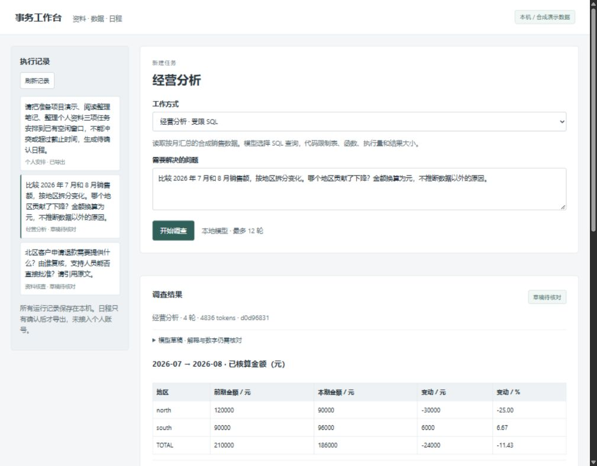

# 事务工作台

三个本地 Agent，共用模型接入和执行记录，处理资料核查、经营分析和个人安排。它们的工具、结束条件和可执行动作各不相同。

| 版本 | 可演示任务 | 代码负责的边界 |
| --- | --- | --- |
| 资料核查 | 查北区退款资料，找出申请要求、复核人和原文 | 服务端身份、租户/角色过滤、引用原文与版本复核、无资料转人工 |
| 经营分析 | 对比两个月的销售额，找出地区贡献 | SQLite 只读授权、函数白名单、查询预算、分到元的确定性计算 |
| 个人安排 | 把三项待办放入空闲窗口 | 工具随阶段开放、时长/冲突/截止时间检查、人工确认后导出 ICS |

**样例均为合成数据。** 没有接入企业生产库、邮箱或个人日历账号。模型使用本机 Ollama，原厂付费 API 在本工作台中禁用。



## 运行

Python 3.14、已安装的 Ollama；核心代码不需要额外 Python 包。先做离线检查：

```powershell
python check.py
python desk.py init
ollama pull qwen3-vl:2b-instruct
python desk.py serve
```

打开 http://127.0.0.1:8805/ ，选版本并运行。Windows 可用 `local.ps1 start / stop / status`。首次初始化只创建私有运行目录，不改其他项目。

CLI 可以单独运行每个版本；与网页服务共用同一运行目录时需先停止服务，单写入锁会拒绝第二个操作进程：

```powershell
python desk.py run knowledge "退款申请需提供什么？请给出原文。"
python desk.py run analyst "Compare July and August 2026 revenue by region."
python desk.py run planner "Schedule all tasks and propose a calendar."
python desk.py list
python desk.py show <run-id>
python desk.py approve <run-id> --reason "已逐项核对合成待办、已有事件和截止时间"
```

日历导出到 `runtime/exports/<run-id>.ics`，可由本人导入日历软件。导出不等于已经创建线上日程，不含参会人、邀请或自动通知。

## 核验方式

`check.py` 的 [13 组检查](docs/checks.json) 使用临时数据库、脚本模型和真实本机 HTTP。包括 SQL 越权/超量、跨租户引用、授权撤回、资料变化、日程冲突、重复批准和中断处理。它们不测模型智力。

另有[实际网页操作记录](docs/browser-runs.json)：三个版本各运行一次，日程经界面确认后生成含三个事件的本机文件；没有向外部日历账户发送邀请。[日程画面](docs/screenshots/planner.png)

```powershell
python evaluate.py --out runtime/model-evaluation.json
```

该命令另建隔离演示目录，调用真实本地模型，依次运行四道固定题，不导出日历。原始记录：[第一次运行](docs/model-first-run.json)、[修改后运行](docs/model-evaluation.json)。每道题只跑一次，不是独立标注的准确率评测。

第一次运行出现了未结束的资料调查、金额单位误写和规划预算耗尽。随后调整为：有证据的纯文本结论通过代码校验后才结束；金额计算交给确定性工具；规划工具按当前阶段开放。模型原稿仍可能写错数字，因此界面默认折叠，主要展示来源和计算结果。[实测与已知限制](docs/verification.md)

## 换成自己的输入

- **资料**：复用 [support-evidence-gateway](https://github.com/fanqiye/support-evidence-gateway) 的导入、授权和审计。文档结构见 `examples/documents.json`；可运行 `python vendor/gateway.py --db runtime/knowledge.sqlite3 ingest <documents.json>`。已有文档改内容或权限必须提高版本。当前工作台读者绑定 north/support，模型不能切换身份。
- **数据**：CSV 格式见 `examples/sales.csv`。停止工作台后运行 `python desk.py import-sales <sales.csv>`；整批校验通过才替换分析表。金额必须为整数分，退货数不超过订单数，不接受重复的月份/地区/产品组合。
- **日程**：编辑私有 `runtime/calendar.json` 的待办、忙碌时段与空闲窗口，重新发起规划。时间必须包含显式 UTC 偏移。旧草案不能在输入变更后批准。

私有输入、令牌、执行消息和日历文件都留在 `runtime/`，不提交 GitHub。销售表可覆盖整个操作员的数据集，**不是租户隔离的 BI 服务**。

## 执行与取舍

`desk.py` 保存运行状态与逐次工具记录。每次模型调用后重新检查任务状态；取消后不会生成可批准结果。工具参数按角色独立验证，不靠提示词阻止未知工具。预算为 12 轮、累计 20000 tokens 的轮次阈值、480 秒的轮次边界检查；一次网络调用最多 90 秒，可能越过总时间阈值。

资料和数据版本会在完成前再检查，规划在批准时再核对全部约束。网页一次只运行一个模型任务，最多保留五个排队/运行任务；中断后转人工核对，不自动重放。需要持久队列、租约续跑和真实 SaaS 写入恢复，可看配套的 [commerce-case-agent](https://github.com/fanqiye/commerce-case-agent)。

日程规划每次最多提供三个可用时段，采用阶段约束的工具调用；没有求全局最优解或复现 ToT。当前不支持时区规则/夏令时自动换算、重复事件、ICS 导入、跨账号同步。

这是可信本机操作员界面，只有 loopback 监听、Host/Origin 校验和浏览器操作 nonce，不是 SSO 或多用户权限系统。不要直接映射到公网。

[代码来源](docs/provenance.md) · [运行与恢复](docs/runbook.md) · [演示与复核](docs/verification.md)
